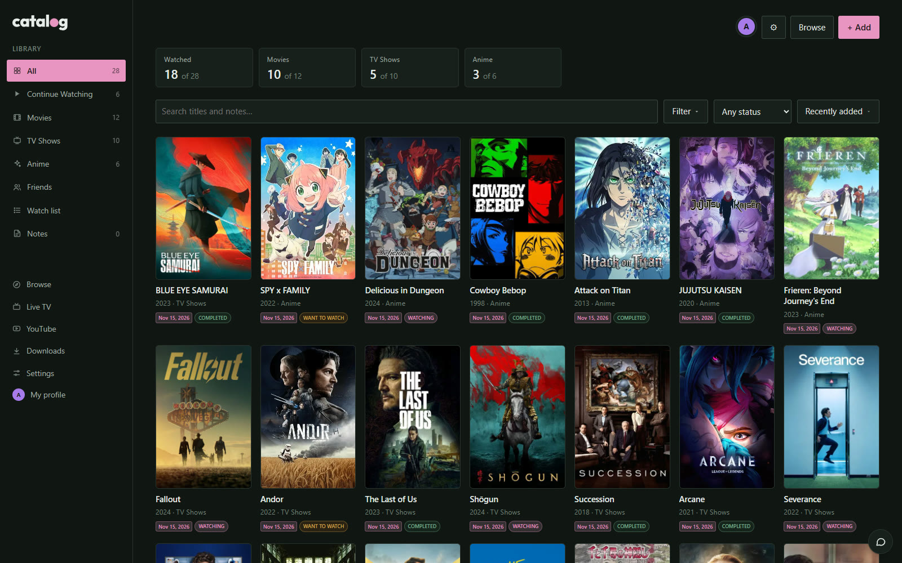
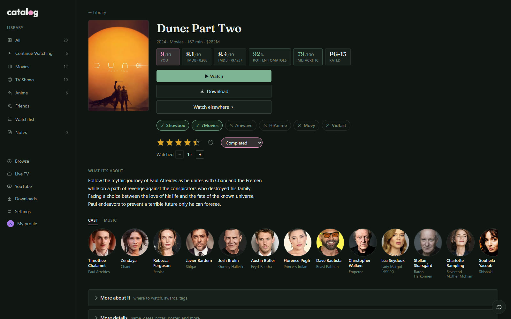
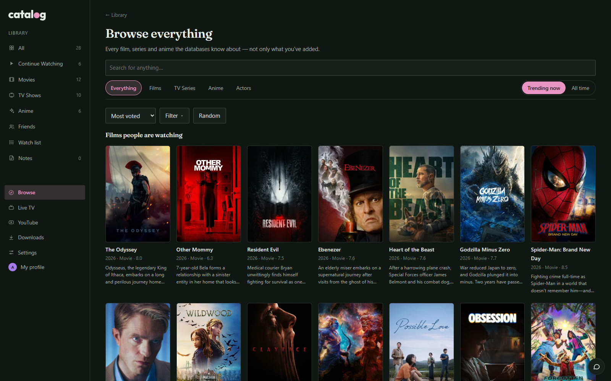
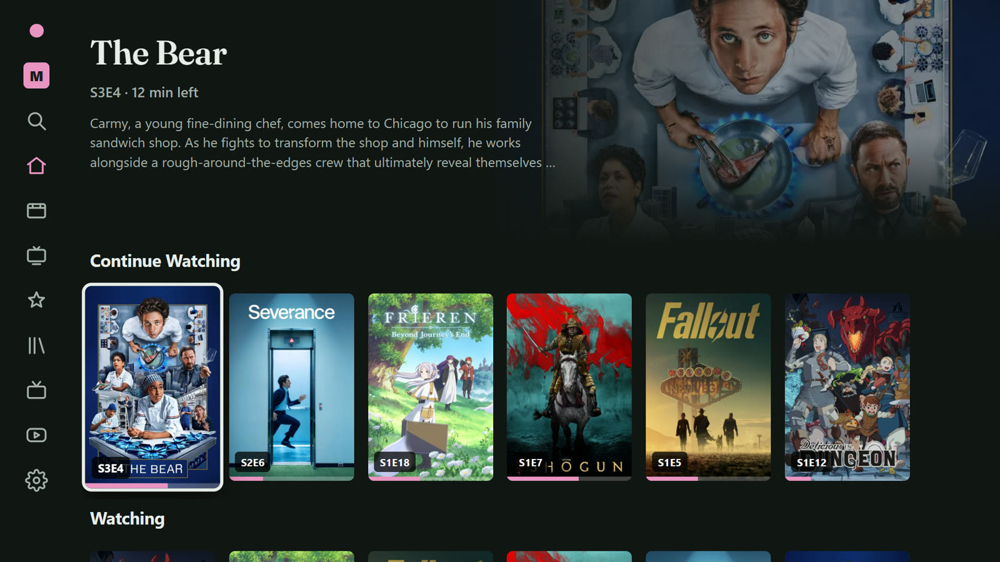
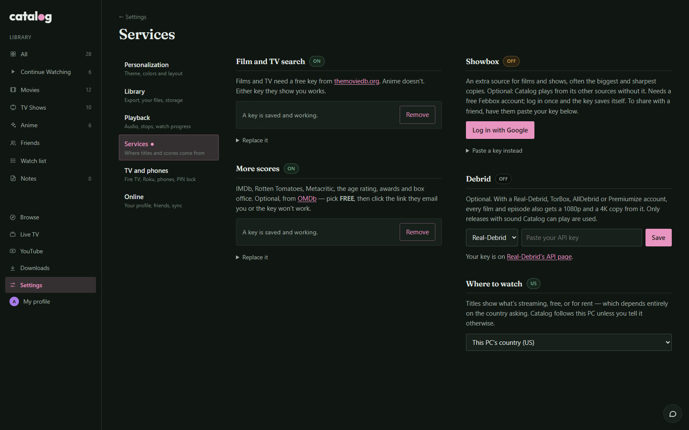

<div align="center">


# Catalog

**Everything you've watched, and everything you want to watch, in one app.**

A library for films, TV and anime with its own player. It runs on your computer and plays on your TVs and phones too.

**[Download the latest release](https://github.com/r5vx/catalog/releases/latest)** · Windows · Mac · Linux

</div>

<br>



## Why Catalog

- **Works as soon as it's installed.** Sources are built in. There are no add-ons to hunt for and you don't need a paid service.
- **A library, not just a player.** Everything you've watched, with ratings, statuses, notes and what's next.
- **Subtitles that fit.** Catalog picks them and times them to the sound by itself.
- **Skip Intro and Skip Credits** on most shows and anime.
- **One computer for the whole house.** Fire TVs, Rokus and phones play through it, each person with their own profile and progress.
- **More than films.** Live TV, sports and YouTube without ads, in the same app.
- **Watch with friends.** Watch together in step, chat while you watch, see what friends are watching.
- **Debrid if you have it.** Real-Debrid, TorBox, AllDebrid and Premiumize work too, but you don't need one.

## Screenshots

<table>
  <tr>
    <td></td>
    <td></td>
  </tr>
  <tr>
    <td align="center">Title page</td>
    <td align="center">Browse</td>
  </tr>
  <tr>
    <td></td>
    <td></td>
  </tr>
  <tr>
    <td align="center">On a TV</td>
    <td align="center">Services, with debrid</td>
  </tr>
</table>


## What Catalog is

Catalog started as a list of everything its author had watched, and grew into the app they watch everything in. It's three things at once:

- **A library you keep.** Every film, show and anime you've seen or want to see, with your ratings, statuses, dates, notes and progress, in one file on your computer.
- **A player that finds the video.** Press Watch and Catalog looks across its built-in sources, picks the sharpest copy, finds subtitles and times them to the sound, and skips the intro for you.
- **The house's TV box.** One computer runs Catalog and every Fire TV, Roku and phone in the house plays through it, each person with their own profile.

Everything else (Live TV, YouTube, friends, Notes) grew around those three.

## Features

**Your library**
- Films, TV shows and anime, each in its own tab, with posters and details from TMDB and AniList
- Statuses: Watching, Completed, Want to watch, On hold, Dropped, Rewatching and Caught up
- Ratings out of 5 or 10 stars, a review, favorites and how many times you've watched it
- Started and Finished dates that fill themselves in as you watch
- Progress kept by itself: the episode you're on, and where you stopped in it
- Continue Watching, with the time left, and shows you're caught up on coming back when a new episode is out ("New ep in 3 days")
- Sort by your rating, IMDb, Rotten Tomatoes, Metacritic, box office, date added and more; filters are remembered
- Stats as tiles, with your last watched posters
- Search finds anime by either name and films by their original titles
- Profiles for everyone in the house, each with their own library, progress and settings
- An optional PIN to lock Catalog
- Import everything you've watched from MyAnimeList, AniList, Kitsu, Letterboxd or IMDb, or paste a list
- Export everything as a backup you can restore

**Watch lists**
- Franchises in the order to watch them, with your progress and what's up next
- Ready-made lists: MCU, Ultimate Marvel, Star Wars, DC Universe and Ultimate DC
- Skip a title, show or hide the extras, and jump straight to where you are

**Finding something to watch**
- Browse what's trending now or the best of all time, by genre, for films, shows and anime
- Random: a box that bursts open with a pick, glowing by its rating, with Roll again
- More like this under every title, matched on taste, topic, genre, director and series (not on ratings)
- Title pages with cast, the season's episodes, an episode ratings chart, where to stream it legally, and which friends watched it
- Cast and crew pages, including the video games an actor has voiced
- A Music tab: who did the music, the soundtrack's songs, and an anime's openings and endings
- IMDb, Rotten Tomatoes and Metacritic scores, age ratings, awards and box office
- Lists from Stremio addons as rows on Browse

**The player**
- Picks the sharpest copy it can find, up to 4K, and shows each copy's real sharpness
- Sources built in: Showbox (with a free Febbox account), 7Movies, Movy, Vidfast, Aniwave and HiAnime
- Optional debrid (Real-Debrid, TorBox, AllDebrid, Premiumize) and Stremio addons, only using releases whose sound it can play
- Falls back to another source by itself when one stops, keeping the same audio language
- Fetches ahead while you watch so it doesn't stop to buffer, and gets the next episode ready
- Japanese audio for anime by default, and dubbed audio in Spanish, French, German or Hindi where there's a copy
- Skip Intro, Skip Recap and Skip Credits, from skip databases or found by comparing episodes' sound, with auto-skip
- Next episode by itself, preview pictures on the progress bar, volume up to 300%
- A mini player that stays on top in the corner, and leaving the player keeps the video ready for 30 minutes
- Rate a film or a series right where it ends
- Playback stats and a log of every time a video stopped to load, with a best guess at why
- Xbox and PlayStation controllers work everywhere

**Subtitles and captions**
- Found by themselves from OpenSubtitles and others, in your language, matched to the copy you're watching
- Auto-timing: Catalog listens to the episode and moves subtitles that are early or late to match the talking, part by part, and checks them by matching the words said (Whisper)
- Adverts and translator credits taken out of subtitle files
- Anime signs and songs drawn as their makers styled them, with karaoke and the file's fonts
- Caption size, look, delay and a Retime button; right-click a caption to copy it
- Captions on Live TV, timed to the commentary

**Downloads**
- Download a film, an episode, a season or a whole show from its page or the player, in 720p and up, with captions
- Captions auto-time on downloads too, with no internet
- A Downloads page to play, delete or send one to a phone

**Live TV and sports**
- Today's and tomorrow's games by sport, with the channels showing each, team logos and live scores
- About 900 channels, plus TV shows like Jeopardy! and SNL
- Favorite teams first, saved games that start by themselves, and the channel that played best picked for you
- Replays of NFL, college football, NBA, WNBA and soccer games with no ads

**YouTube**
- YouTube's own website with no ads before videos, in its own window or inside Catalog, with tabs
- On Fire TV, Roku and phones too, with each person's own YouTube account

**TVs and phones**
- A Fire TV app, installed and updated from the computer, laid out like Netflix, with Who's watching
- A Roku app laid out the same way (beta)
- Phones through [Tailscale](https://tailscale.com), as an app on the home screen, with downloads kept on the phone to watch offline
- The TV matches the video's frame rate on Fire TV, so slow pans don't judder

**Online (optional, off until you join)**
- Friends by code, profiles with a banner, a name style (fonts, gradients, glow, shimmer), favorites and highest rated
- See what friends are watching and what they've rated, and their whole library
- Watch together in a room (play, pause and skips happen in every house) or watch along with a friend
- Whispers that pop up even while watching, group chat in a room, and a Messages page
- Your progress and library kept in step on every computer you use
- Problems report themselves, so they can be fixed

**Notes**
- A notes section with lists, tags, pins, search and find-in-note
- Lock a note behind your PIN, version history, and Recently deleted for 7 days

**Look**
- Light, dark, black and a Custom theme where you pick every color
- An accent color, a background picture you can move, zoom, dim and blur, and a wide layout with a sidebar
- Your own logo and desktop icon, sized and placed to fit

## Install

**Windows:** download **Catalog-Setup.exe** from the [latest release](https://github.com/r5vx/catalog/releases/latest). Windows warns about an unknown publisher: click **More info**, then **Run anyway**. Updates install by themselves.

**Mac:** download the **.dmg** from the same page and drag Catalog to Applications. The app isn't signed, so the first time, open Terminal and run:

```
xattr -cr /Applications/Catalog.app
```

After that Catalog updates itself.

**Linux:** download the **.AppImage**, then make it runnable and open it:

```
chmod +x Catalog-*-linux-x86_64.AppImage
./Catalog-*-linux-x86_64.AppImage
```

Some distributions need FUSE 2 (Ubuntu 22.04 and later: `sudo apt install libfuse2`). If it closes straight away on Ubuntu 24.04 or later, start it with `--no-sandbox`. It updates itself when it sits in a folder you can write to.

## Setup

All of these are in **Settings → Services**.

| What | Needed? | Where to get it |
| --- | --- | --- |
| TMDB key | For films and TV (anime works without) | Free at [themoviedb.org](https://www.themoviedb.org/settings/api) |
| OMDb key | Optional: IMDb, Rotten Tomatoes and Metacritic scores | Free at [omdbapi.com](https://www.omdbapi.com/apikey.aspx) |
| Febbox account | Optional: adds Showbox, often the sharpest copies | Free at [febbox.com](https://www.febbox.com), then log in from Catalog |
| Debrid key | Optional | Your debrid service's API page |

**Phones:** install Tailscale on your computer and your phone with the same account, then open `http://<your computer's Tailscale address>:4173` on the phone.

**TVs:** Settings → TV and phones.

## Privacy

Catalog has no ads, no analytics and no tracking. Your library, notes, ratings and settings are kept in one file on your computer, and no account is needed.

- **Catalog online is off until you join** (Settings → Online). It then talks to a small server run by Catalog's author on Cloudflare, which gets only what those features need: your name and picture, your friends, what you're watching now, the titles you've watched and rated, your progress and library when sync is on, your profile, your messages and watch-together rooms. No video passes through it. Messages are kept 90 days and aren't end-to-end encrypted.
- **Problem reports** (on once you're online, off in Settings → Online) send the title, the source and the player's log. Web addresses in them are cut short.
- **Never sent anywhere:** your keys, your Febbox sign-in or anything else from Settings. Exports and backups leave them out too.
- **Other services see your IP address** when Catalog asks them for something: TMDB, AniList, OMDb, MusicBrainz, AnimeThemes, Jikan, subtitle sites, the sites videos play from, and GitHub for updates. With debrid on, Torrentio gets the title's IMDb id and your debrid service gets your key and the release it's asked for.

## Legal

- Catalog does not host, store, upload or share any films, shows or other copyrighted material. Video plays straight from third-party websites that Catalog doesn't own or run.
- You are responsible for having the right to watch or download what you open with Catalog, and for following the law where you live. If a title is available legally where you are, please watch it there.
- Catalog's author does not endorse copyright infringement and doesn't make money from Catalog. Questions about a video belong to the site that hosts it.
- Titles, posters and artwork belong to their owners and are shown only to identify what's in your library.
- This product uses the TMDB API but is not endorsed or certified by TMDB. Catalog is not affiliated with TMDB, AniList, OMDb, MusicBrainz, AnimeThemes, MyAnimeList, YouTube, Torrentio, any debrid service, or any video or subtitle site.
- Catalog comes as it is, without warranty of any kind. Its author is not liable for any loss or damage from using it, including lost library data. Keep a backup.

<details>
<summary><b>Building from source</b></summary>

<br>

Needs [Node.js](https://nodejs.org) 24.

```
npm install
npm run app        run the desktop app from source
npm run dev        development server with live reload
npm run check      type-check the project
npm run backup     back up now
npm run restore    preview a restore (-- --write to apply)
npm run release    build, pack and publish a new version
```

To use a JSON backup downloaded from **Settings → Library**, run
`npm run restore -- --from "path/to/catalog-backup.json"` to preview it. Close
Catalog, then add `--write` to restore it. Use `--to "path/to/library.db"` to
restore into a separate database. JSON backups do not contain settings or
uploaded image files.

| What | Where |
| --- | --- |
| Colors and fonts | `src/app.css`, all at the top |
| Every database query | `src/lib/server/db/queries.ts` |
| Schema and migrations | `src/lib/server/db/index.ts` |
| Outside data | `src/lib/server/metadata/` |
| Video sources | `src/lib/server/sources/` |
| Desktop wrapper | `electron/main.cjs` |
| Online server | `cloud/` |

</details>
