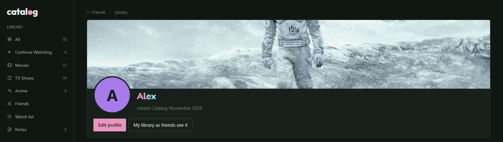

<div align="center">


# Catalog

**Everything you've watched, and everything you want to watch, in one app.**

A library for films, TV and anime with its own player. It runs on your computer and plays on your TVs and phones too.

**[Download the latest release](https://github.com/r5vx/catalog/releases/latest)** · Windows · Mac · Linux

</div>

<br>


## Why Catalog

- **Works as soon as it's installed.** Sources are built in. There are no add-ons to hunt for and you don't need a paid service.
- **A library, not just a player.** Everything you've watched, with ratings, statuses, notes and what's next.
- **Subtitles that fit.** Catalog picks them and times them to the sound by itself.
- **Skip Intro and Skip Credits** on most shows and anime.
- **One computer for the whole house.** Fire TVs, Rokus and phones play through it, each person with their own profile and progress.
- **More than films.** Live TV, sports and YouTube without ads, in the same app.
- **Watch with friends.** Watch together in step, chat while you watch, see what friends are watching.
- **Debrid if you have it.** Real-Debrid, TorBox, AllDebrid and Premiumize work too, but you don't need one.

## Screenshots

<table>
  <tr>
    <td></td>
    <td></td>
  </tr>
  <tr>
    <td align="center">Title page</td>
    <td align="center">Browse</td>
  </tr>
  <tr>
    <td></td>
    <td></td>
  </tr>
  <tr>
    <td align="center">On a TV</td>
    <td align="center">Services, with debrid</td>
  </tr>
</table>



## Features

**Library**
- Films, TV and anime, with statuses: watching, completed, want to watch, rewatching, caught up
- Your ratings out of 5 or 10 stars, notes, a watch list and stats
- Continue Watching, with new episodes as they come out
- Profiles for everyone in the house, each with their own list and progress
- Import from a list, and export everything as a backup you can restore

**Finding something to watch**
- Browse what's trending or the best of all time, by genre, or a random pick
- More like this, based on what you've watched
- Cast and crew pages, including the video games an actor has voiced
- Soundtracks and anime openings and endings on every title
- IMDb, Rotten Tomatoes and Metacritic scores, and an episode ratings chart for shows

**Player**
- Picks the sharpest copy it can find, up to 4K
- Subtitles from OpenSubtitles, timed to the sound automatically
- Anime signs and songs drawn as their makers styled them
- Skip Intro and Skip Credits, next episode by itself, a mini player
- Downloads to watch with no internet
- Japanese audio by default for anime

**Sources**
- Built in: Showbox (with a free Febbox account), 7Movies, Movy, Vidfast, Aniwave and HiAnime
- Optional debrid: Real-Debrid, TorBox, AllDebrid or Premiumize. Catalog only uses releases with sound it can play.

**TVs and phones**
- A Fire TV app, installed from Catalog on your computer
- A Roku app (beta)
- Phones and tablets through [Tailscale](https://tailscale.com), added to the home screen like an app

**Live TV and YouTube**
- Live channels and a sports schedule with team logos and live scores
- Replays of NFL, NBA and soccer games
- YouTube with no ads, in tabs

**Online (optional)**
- Friends, profiles with a banner picture and your own name style
- See what friends are watching and what they've rated
- Watch together, with group chat and messages
- Your library and progress kept in step on every computer you use

**Look**
- Light, dark and black themes, or your own colors
- Any accent color and a background picture

## Install

**Windows:** download **Catalog-Setup.exe** from the [latest release](https://github.com/r5vx/catalog/releases/latest). Windows warns about an unknown publisher: click **More info**, then **Run anyway**. Updates install by themselves.

**Mac:** download the **.dmg** from the same page and drag Catalog to Applications. The app isn't signed, so the first time, open Terminal and run:

```
xattr -cr /Applications/Catalog.app
```

After that Catalog updates itself.

**Linux:** download the **.AppImage**, then make it runnable and open it:

```
chmod +x Catalog-*-linux-x86_64.AppImage
./Catalog-*-linux-x86_64.AppImage
```

Some distributions need FUSE 2 (Ubuntu 22.04 and later: `sudo apt install libfuse2`). If it closes straight away on Ubuntu 24.04 or later, start it with `--no-sandbox`. It updates itself when it sits in a folder you can write to.

## Setup

All of these are in **Settings → Services**.

| What | Needed? | Where to get it |
| --- | --- | --- |
| TMDB key | For films and TV (anime works without) | Free at [themoviedb.org](https://www.themoviedb.org/settings/api) |
| OMDb key | Optional: IMDb, Rotten Tomatoes and Metacritic scores | Free at [omdbapi.com](https://www.omdbapi.com/apikey.aspx) |
| Febbox account | Optional: adds Showbox, often the sharpest copies | Free at [febbox.com](https://www.febbox.com), then log in from Catalog |
| Debrid key | Optional | Your debrid service's API page |

**Phones:** install Tailscale on your computer and your phone with the same account, then open `http://<your computer's Tailscale address>:4173` on the phone.

**TVs:** Settings → TV and phones.

## Privacy

Catalog has no ads, no analytics and no tracking. Your library, notes, ratings and settings are kept in one file on your computer, and no account is needed.

- **Catalog online is off until you join** (Settings → Online). It then talks to a small server run by Catalog's author on Cloudflare, which gets only what those features need: your name and picture, your friends, what you're watching now, the titles you've watched and rated, your progress and library when sync is on, your profile, your messages and watch-together rooms. No video passes through it. Messages are kept 90 days and aren't end-to-end encrypted.
- **Problem reports** (on once you're online, off in Settings → Online) send the title, the source and the player's log. Web addresses in them are cut short.
- **Never sent anywhere:** your keys, your Febbox sign-in or anything else from Settings. Exports and backups leave them out too.
- **Other services see your IP address** when Catalog asks them for something: TMDB, AniList, OMDb, MusicBrainz, AnimeThemes, Jikan, subtitle sites, the sites videos play from, and GitHub for updates. With debrid on, Torrentio gets the title's IMDb id and your debrid service gets your key and the release it's asked for.

## Legal

- Catalog does not host, store, upload or share any films, shows or other copyrighted material. Video plays straight from third-party websites that Catalog doesn't own or run.
- You are responsible for having the right to watch or download what you open with Catalog, and for following the law where you live. If a title is available legally where you are, please watch it there.
- Catalog's author does not endorse copyright infringement and doesn't make money from Catalog. Questions about a video belong to the site that hosts it.
- Titles, posters and artwork belong to their owners and are shown only to identify what's in your library.
- This product uses the TMDB API but is not endorsed or certified by TMDB. Catalog is not affiliated with TMDB, AniList, OMDb, MusicBrainz, AnimeThemes, MyAnimeList, YouTube, Torrentio, any debrid service, or any video or subtitle site.
- Catalog comes as it is, without warranty of any kind. Its author is not liable for any loss or damage from using it, including lost library data. Keep a backup.

<details>
<summary><b>Building from source</b></summary>

<br>

Needs [Node.js](https://nodejs.org) 24.

```
npm install
npm run app        run the desktop app from source
npm run dev        development server with live reload
npm run check      type-check the project
npm run backup     back up now
npm run restore    preview a restore (-- --write to apply)
npm run release    build, pack and publish a new version
```

| What | Where |
| --- | --- |
| Colors and fonts | `src/app.css`, all at the top |
| Every database query | `src/lib/server/db/queries.ts` |
| Schema and migrations | `src/lib/server/db/index.ts` |
| Outside data | `src/lib/server/metadata/` |
| Video sources | `src/lib/server/sources/` |
| Desktop wrapper | `electron/main.cjs` |
| Online server | `cloud/` |

</details>
